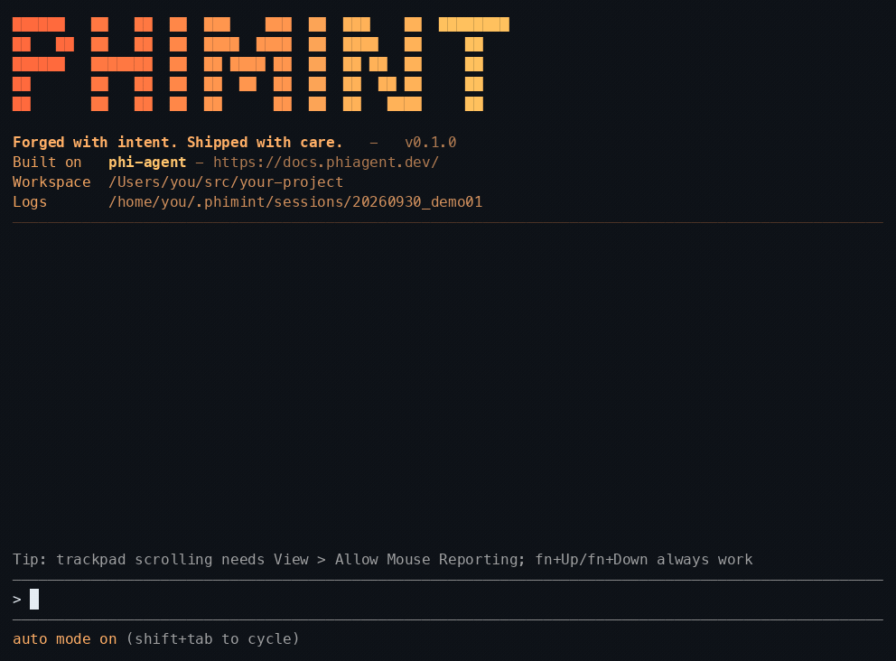

# phimint

**Pronounced** `/ˈfaɪmɪnt/` ("fie-mint", phi + mint).

**A terminal AI coding agent written in Rust — no Node.js or Python, one binary to download, and 1 core with 1 GB of RAM runs a full coding task.**

Built on [phi-agent](https://docs.phiagent.dev/) — the agent runtime ships as its own framework; phimint keeps only the terminal layer.

[](LICENSE-MIT)
[](https://www.rust-lang.org)
[](README_CN.md)



*phimint needs one API key in `~/.phimint/config.json` — a one-minute step, see [Quick start](#quick-start).*

Project page: [hibuka-labs.github.io/phimint](https://hibuka-labs.github.io/phimint/) — English / [中文](https://hibuka-labs.github.io/phimint/zh/).

## Features

- **Light by nature** — a single static Rust binary with zero runtime dependencies: no Node.js, no Python. SSH onto a bare 1-core 1-GB server, one curl line, and you're in a full coding session.
- **Native LSP fast inner loop** — per-language servers start lazily (rust-analyzer / typescript-language-server / clangd); seconds after an edit you get `file:line:col` diagnostics, no recompile. A tree-sitter repo map plus ripgrep pulls context on demand instead of stuffing the repo into the window.
- **CodeAct does the grunt work** — bulk renames and data wrangling ride one Python script instead of a long chain of single-purpose tool calls. The session is resident: last call's variables and functions are still there for the next, and intermediate data stays local instead of round-tripping the model — fewer round-trips is where the tokens are saved. Works fine without Python; the engine sits behind a compile-time switch, `--no-default-features` drops it entirely.
- **Parallel sub-agents** — run several investigations at once: read-only by default, write capability requested per spawn; reports are pushed at the turn boundary, no polling; the task panel tracks each one live.
- **UI & product design support** — for layout or option trade-offs, candidates are laid out side by side on a browser canvas; your click comes back as a real user turn — the agent never decides for you. Conceptual questions go through a terminal picker (`ask_user`, 2–4 options).
- **Plugin model** — everything is a plugin: MCP servers, user scripts and wasm packs all plug in behind the same contract (WIT + Component Model), so adding capability never means touching the core. `/tools` lists every tool's source, namespace and permission tier, with one-key disable.
- **Model tiers that match the budget** — `main` for the conversation, `lite` for sub-agents and summaries, `advanced` for the hard problems; cheap work never burns the expensive model.
- **You stay in control** — approval modes `auto` / `ask` / `deny` (sub-agents inherit them); secrets land on disk only as `${ENV:VAR}` references; the desktop agent can look at your screen and move the pointer, but asks every time before changing anything.

## Quick start

Three steps to a running agent: install a prebuilt binary (**no Rust required**),
add an API key, run.

### 1. Install

Prebuilt binaries ship with every release (macOS / Linux / Windows, arm64 + x64).
One-liner:

```bash
curl -fsSL https://github.com/hibuka-labs/phimint/releases/latest/download/install.sh | bash
```

Windows (PowerShell):

```powershell
irm https://github.com/hibuka-labs/phimint/releases/latest/download/install.ps1 | iex
```

The installer does the whole job: binary into `~/.local/bin` (PATH handled for
you), download checksum verified, `~/.phimint/config.json` written — all that's
left is the `api_key` line. `PHIMINT_NO_PATH_EDIT=1` keeps `PATH` yours;
`PHIMINT_INSTALL_DIR=<dir>` picks the install directory.

Or use a package manager:

```bash
brew install hibuka-labs/phimint/phimint   # macOS / Linux (Homebrew)
npm install -g phimint                   # also: pnpm add -g phimint / yarn global add phimint
cargo install phimint                    # from crates.io
```

On Windows, [Scoop](https://scoop.sh) is available:

```powershell
scoop bucket add hibuka-labs https://github.com/hibuka-labs/scoop-bucket
scoop install phimint                    # Scoop
```

Upgrade: `phimint update` for one-liner installs, or `brew upgrade phimint` /
`npm install -g phimint@latest` / `cargo install phimint --force` /
`scoop update phimint` — matching how you installed.

Uninstall: `phimint uninstall` — removes the binary and `~/.phimint/` (config
including the API key, sessions, history), plus the PATH entry the installer
added. `--keep-data` keeps the data; `--yes` skips the prompt.

### Supported platforms

| Platform | Minimum | Prebuilt artifacts |
|---|---|---|
| Linux | glibc 2.28 (Ubuntu 20.04, Debian 11, Rocky/Alma 8, Fedora 33+) | `x86_64`, `aarch64` |
| Windows | Windows 10 1809+ (installer needs PowerShell 5.1+) | `x86_64` |
| macOS | 12+ | Apple Silicon, Intel |

Linux binaries link against glibc 2.28 so they start on older distros; CI
builds and tests on Linux, Windows and macOS. Source installs
(`cargo install`) follow your own toolchain instead.

### 2. Configure

A one-minute step: you need an API key for any supported model provider
(OpenAI / Anthropic / DeepSeek / Aliyun / Moonshot / Gemini / Ollama …).

The installer already wrote `~/.phimint/config.json` — open it and fill in the
`api_key` line. Installed another way? `phimint init` writes the same file, or
`phimint config set api_key sk-xxx` does it for you. `phimint config show`
prints what phimint resolved, with the key masked.

With no usable key — not in the file, not in `--api-key`, not in
`PHIMINT_API_KEY` — phimint stops before the first turn and names the file to
edit; it never starts a conversation it cannot pay for. If the endpoint turns
the key down later (401/403), one notice in the transcript names the file, the
masked key and the endpoint, so a dead key is a one-line fix instead of a
silent failure.

The file is JSON5 — comments and trailing commas welcome:

```json
{
  "base_url": "https://api.openai.com/v1",
  "api_key": "sk-xxx",
  "main": "gpt-5.4-mini",
  "lite": "gpt-4o-mini",
  "advanced": "o1-preview"
}
```

Different provider per tier — each tier can be an object with its own `model` /
`base_url` / `api_key`:

```json
{
  "main":     { "model": "gpt-5.4-mini", "base_url": "https://api.openai.com/v1", "api_key": "sk-openai" },
  "lite":     { "model": "deepseek-chat", "base_url": "https://api.deepseek.com/v1", "api_key": "sk-deepseek" },
  "advanced": { "model": "claude-opus-4", "base_url": "https://api.anthropic.com", "api_key": "sk-ant" }
}
```

Three tiers, three jobs: `main` is the chat session you talk to, `lite` is the
cheap lane (sub-agents and the completion judge default to it), `advanced` is
the strong lane for the work that deserves it. An unconfigured tier follows
`main`, so a one-model setup keeps working. `/lite <name>` and
`/advanced <name>` retarget a tier; `/models` lists what is configured.

`/model` switches the conversation's model for this session only, as a top-level
`model` selection pointer that overrides `main` without rewriting the tier
definitions. Bare `/model` opens a picker (with a *Clear selection* row); a
cleared selection falls back to the configured `main`.

Or pass everything on the command line (see `config.json.example` for the full schema):

```bash
phimint --model gpt-5.4-mini --base-url https://api.openai.com/v1 --api-key sk-xxx
```

`config.json` also carries optional sections: `update` (update channels and
manifest endpoints for automated update checks) and `ui.popup` (the `@`/`/`
popup band's layout and dimensions).

### 3. Run

```bash
cd your-project && phimint
```

Type a task at the composer — e.g. `add a cached get_user function to the lib` —
and watch it read the code, edit, compile, and test until green. Keys, approval
modes, and a full walkthrough live in the [user manual](docs/USAGE.md).

## Quick reference

| Key | Action |
|---|---|
| `Enter` | send |
| `Ctrl+J` | newline in the composer |
| `Shift+Tab` | toggle the approval mode (`auto` ⇄ `ask`) |
| `Up` / `Down` | recall sent inputs |
| `Ctrl+C` | copy selection → cancel the run → clear the draft → quit |
| `Ctrl+V` | paste a screenshot |
| `Esc` | clear the selection, else the composer |

Approval modes: `auto` (everything allowed) · `ask` (confirm each write) ·
`deny` (read-only). Sub-agents inherit the mode of the main agent.

Common commands: `phimint update` · `phimint uninstall` · `phimint init` ·
`phimint config show` · `phimint --resume`.

Full key map, every flag, the tool surface, session files and internals:
**[docs/USAGE.md](docs/USAGE.md)** — [中文](docs/USAGE_CN.md).

## Versioning

phimint is on **0.x**: every released version installs, runs, and self-updates, but the **public API is not
guaranteed to be backward compatible**. If you use it as a library, pin the exact version
(`phimint = "=0.13.0"`); API stability is promised from 1.0 onwards.

Details: [docs/versioning-policy.md](docs/versioning-policy.md).

## License

MIT OR Apache-2.0 — see [LICENSE-MIT](LICENSE-MIT) and [LICENSE-APACHE](LICENSE-APACHE).

## Contact

GitHub Issues — [hibuka-labs/phimint](https://github.com/hibuka-labs/phimint/issues)

If you find phimint useful, a ⭐ helps others discover it.

[中文](README_CN.md)
