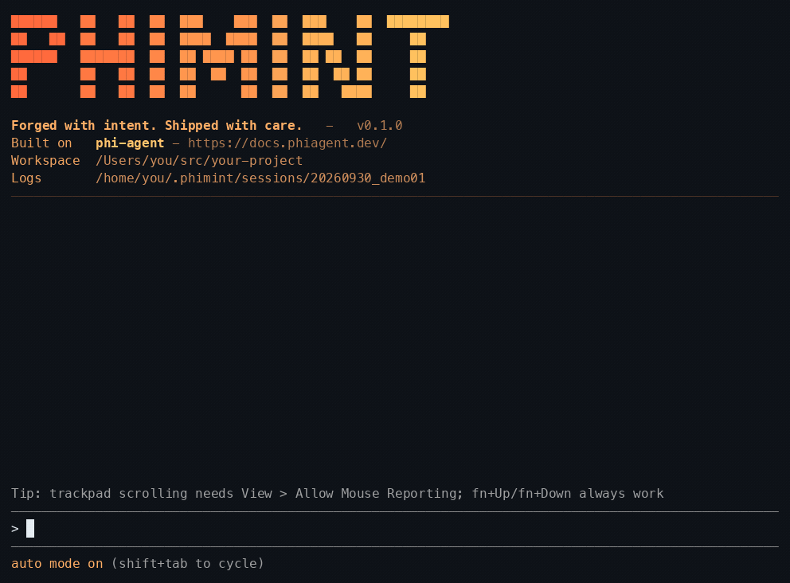

# phimint

**读作** `/ˈfaɪmɪnt/`（phi-mint，同英文 "fie-mint"），不是「皮敏特」。

基于 [phi-agent](https://docs.phiagent.dev/zh/) 构建的终端 AI 编码 agent——底层是那个「不只是会聊天，更能把事做好」的 Agent 运行时底座。

[](LICENSE)
[](https://www.rust-lang.org)
[](README.md)



*phimint 只需在 `~/.phimint/config.json` 里配一个 API key——一分钟的事，见[快速开始](#快速开始)。*

phimint 跑「理解需求 → 读码 → 多文件改 → 编译/测试 → 报错迭代」的完整编码链路。

产品页：[hibuka-labs.github.io/phimint/zh](https://hibuka-labs.github.io/phimint/zh/) — 中文 / [English](https://hibuka-labs.github.io/phimint/)。

## 特性

- **代码单元（CodeAct）**：`code_cell` 在常驻 Python 会话里跑代码——一次调用就是共享同一会话的一个 cell，变量、import、函数在多次调用之间存活。机械性的多步活（批量改、重命名、数据整理）走一段短 cell 脚本，而不是一长串单用途工具调用。引擎挂在编译期开关后面——`--no-default-features` 可以把它整个从二进制里摘掉。
- **流式 TUI**：ratatui + crossterm，底部固定输入栏、逐字流式输出、工具调用内联、shell 命令逐行实时回显、审批弹窗、启动 banner（自动识别终端明暗配色）。
- **斜杠命令**：兼容 `.claude/skills` 的 skill 体系，`/skill-name args` 把 skill 正文注入本轮；`/resume` 交互式选择并恢复历史会话。
- **外部工具**：一套契约（WIT + Component Model）接入三种自定义工具——MCP 服务（`/connect`）、用户脚本、wasm 插件包（`plugin add` / `plugin remove`）。`/tools` 一屏列出全部工具的来源/命名空间/档位并可一键关闭；secret 只以 `${ENV:VAR}` 引用落盘、绝不存明文；`add_tool` 让 agent 代写工具，全貌确认卡（argv、绝对路径、超时）点头后才注册。
- **拉取式上下文**：`repo_map`（tree-sitter 符号/结构索引）+ `search_content`（ripgrep），agent 主动搜、主动读，而非把整个仓库塞进 context。
- **LSP 快速内环**：多 server 懒启动（rust-analyzer / typescript-language-server / clangd），改完不重编译秒级拿到 `file:line:col` 诊断；server 起不来降级到 shell。
- **多 agent 扇出 + 推送式 fan-in**：`spawn_agent` 派子 agent 调查（默认只读；任务需要动手改代码时，按次申请写能力），主 agent **结束回合即收全量报告**（无需轮询）；TUI 任务面板逐子 agent 实时跟踪，单任务 10 分钟超时硬停。
- **设计画布 & `ask_user`**：agent 可以把选项*展示*给你而不是描述给你——2–4 个候选以屏幕形式落在你的浏览器里（布局样机、选项组、对比图），点一下就变成真实的用户回合；概念选择也可以直接在终端选择器里问（`ask_user`）。浏览器只在一次性同意后才打开，忙碌时的点击排队到回合边界再送达，屏幕等你点选期间 run 会停驻——agent 绝不替你拍板设计选择。
- **桌面操作 + 同意门**：agent 可以看你的屏幕、挪你的指针。*看*和*挪*从不问；*改*机器则每次都问，走的还是工具路径那扇同意门。
- **审批三态**：`auto`（全自动）/ `ask`（写操作逐条弹窗）/ `deny`（只读）；子 agent 权限跟随主 agent 模式——`ask` 下每次子 agent 写入都会弹窗确认，弹窗标明是哪个子 agent。
- **防护栏**：reasoning-only 纠偏（连续空转 → 自动关思考）、max-turns 预警（最后 3 轮逼收尾）、provider 截断守卫（谎报 `finish_reason` 的容错，agent-base 提供）、工具输出 16k 上限。
- **多语言**：`code-intel` 注册表（扩展名 → LSP server → 构建命令兜底），Rust / TypeScript / JavaScript / C / C++ 开箱即用。
- **模块化底座**：UI 组件与语言智能已沉淀为独立 crate —— [`phi-tui`](https://github.com/hibuka-labs/phi-tui)（聊天 TUI 组件）与 [`code-intel`](https://github.com/hibuka-labs/code-intel)（LSP/repomap/ripgrep 核心），phimint 只保留产品壳。

## 快速开始

三步跑起来：装上预编译二进制（**不需要 Rust**）、配上 API key、运行。

### 1. 安装

每个版本都提供预编译二进制（macOS / Linux / Windows，arm64 + x64）。
一键安装（国内用户直接用 Gitee 那行）：

```bash
curl -fsSL https://github.com/hibuka-labs/phimint/releases/latest/download/install.sh | bash   # GitHub
curl -fsSL https://gitee.com/chenkangzeng_admin/phimint/releases/download/latest/install.sh | PHIMINT_MIRROR=gitee bash  # Gitee（国内）
```

Windows（PowerShell）：

```powershell
irm https://github.com/hibuka-labs/phimint/releases/latest/download/install.ps1 | iex   # GitHub
$env:PHIMINT_MIRROR='gitee'; irm https://gitee.com/chenkangzeng_admin/phimint/releases/download/latest/install.ps1 | iex  # Gitee（国内）
```

安装脚本把整件事做完：二进制放进 `~/.local/bin`（或 PATH 上第一个可写目录），
需要的话把它写进你的 shell 配置，校验下载的 sha256，并写好一份可直接编辑的
`~/.phimint/config.json`。留给你的只剩那个文件里的 `api_key` 一行——不用
`python3`，不用 `sudo`，也不用自己 `export PATH=`。

想自己管 PATH 就设 `PHIMINT_NO_PATH_EDIT=1`，想指定安装目录就设
`PHIMINT_INSTALL_DIR=<dir>`。

或使用包管理器：

```bash
brew install hibuka-labs/phimint/phimint   # macOS / Linux（Homebrew）
npm install -g phimint                   # 也支持 pnpm add -g / yarn global add
cargo install phimint                    # 从 crates.io
```

升级：一键脚本安装的用 `phimint update`；其余按安装方式选
`brew upgrade phimint` / `npm install -g phimint@latest` / `cargo install phimint --force`。
国内下载走 [Gitee Releases](https://gitee.com/chenkangzeng_admin/phimint/releases)，
更新检查器会自动兜底到 Gitee 镜像。

卸载：`phimint uninstall`。二进制交给当初安装它的渠道去移除，然后删掉 `~/.phimint/`——
里面是配置（含 API key）、会话、历史和笔记。`--keep-data` 保留这个目录，
`--yes` 跳过确认。Windows 上还会摘掉安装脚本加进 PATH 的那条；Unix 上会
从 shell 配置里删掉那段带标记的 PATH 块。

### 2. 配置

一分钟的事：需要任一受支持的模型 provider 的 API key（OpenAI / Anthropic /
DeepSeek / Aliyun / Moonshot / Gemini / Ollama …）。

安装脚本已经写好了 `~/.phimint/config.json`——打开填上 `api_key` 那行就行。
换了别的安装方式就 `phimint init` 生成同一个文件，或用
`phimint config set api_key sk-xxx` 直接写。`phimint config show` 打印
phimint 实际读到的配置（key 打码）。

文件是 JSON5，允许注释与尾逗号：

```json
{
  "base_url": "https://api.openai.com/v1",
  "api_key": "sk-xxx",
  "main": "gpt-5.4-mini",
  "lite": "gpt-4o-mini",
  "advanced": "o1-preview"
}
```

不同 provider 分层配置：

```json
{
  "main": { "model": "gpt-5.4-mini", "base_url": "https://api.openai.com/v1", "api_key": "sk-openai" },
  "lite": { "model": "deepseek-chat", "base_url": "https://api.deepseek.com/v1", "api_key": "sk-deepseek" },
  "advanced": { "model": "claude-opus-4", "base_url": "https://api.anthropic.com", "api_key": "sk-ant" }
}
```

`/model` 切换会写成顶层的 `model` **选择指针**——一个独立字段，存在时覆盖
`main`。切换永远不会改写上面三个档位定义，动的只有这个指针：

```json
{
  "main": "gpt-5.4-mini",
  "model": "gpt-5.4"
}
```

指针可以是一个裸模型名，也可以是只带「与文件默认值不同」的端点字段的对象
（例如 `"model": { "model": "claude-opus-4", "base_url": "https://api.anthropic.com", "api_key": "sk-ant" }`）。
光打 `/model` 会弹出候选模型的挑选框（带一行「清除选择」）；`/model <名字>`
直接按名设置。清除选择即删除指针、回到配置的 `main`。切换永远不碰 `lite`
与 `advanced`；未配置的档位跟随生效的 `main`（指针生效时就是指针）。启动时
若有指针生效，phimint 会在开机提示里点名。

或使用 CLI 参数（完整字段见 `config.json.example`）：

```bash
phimint --model gpt-5.4-mini --base-url https://api.openai.com/v1 --api-key sk-xxx
```

`config.json` 还有可选段：`update`（自动更新检查的渠道与 manifest 端点）与
`ui.popup`（`@`/`/` 补全弹层的布局尺寸）。

### 3. 运行

```bash
cd your-project && phimint
```

在输入栏发一个任务——比如 `帮我在 lib 里加一个带缓存的 get_user 函数`——
它会读代码、改代码、编译、跑测试直到全绿。按键、审批模式与完整走读见[使用](#使用)。

### 从源码运行

需要 Rust 工具链（edition 2024）。可选：各语言 LSP server 在 `PATH` 上以启用
LSP 快速内环（rust-analyzer / typescript-language-server / clangd）；被指向的项目
还需要 `cargo` / `npm` / `make` 等构建工具。其余依赖全部来自 crates.io——
`cargo build` 不需要同级检出任何兄弟仓库。

```bash
cargo run                                # 从源码树启动
cargo run -- -w ../some-project          # 指定工作区目录
```

## 使用

```
phimint [OPTIONS] [COMMAND]

Commands:
  update             升级到最新版本（一键脚本安装的自替换二进制；
                     brew/npm/cargo 安装的给出对应升级命令）。
                     `phimint update --check` 仅检查不升级。

  uninstall          卸载 phimint 并清掉它留下的数据。二进制交给当初
                     安装它的渠道移除，然后删掉 ~/.phimint/（API key、
                     会话、历史、笔记），并摘掉 Windows 上安装脚本加进
                     PATH 的那条。--keep-data 保留 ~/.phimint/。
                     --yes 跳过确认。

  -w, --workspace <PATH>    工作区目录（默认：当前目录）
      --model <NAME>        仅本次运行的主模型名（覆盖 `model` 指针与 `main`，不写回文件）
      --lite-model <NAME>   lite 模型名（覆盖 config.json）
      --advanced-model <NAME>  advanced 模型名（覆盖 config.json）
      --base-url <URL>      API base URL（覆盖 config.json）
      --api-key <KEY>       API key（覆盖 config.json）
      --protocol <PROTO>    API 协议（默认按模型名推断）
      --config <PATH>       配置文件路径（默认 ~/.phimint/config.json）
      --approval <MODE>     auto（默认）/ ask / deny
      --shell-timeout-ms    shell 命令超时（默认 120000）
      --session <ID>        会话 ID（默认自动生成；复用同 ID 续写同一会话）
      --resume              交互式选择历史会话并恢复
      --log-level <LEVEL>   session.log 级别（默认 info）
      --color-scheme <S>    banner 配色：auto（默认，探测终端底色）/ dark / light
      --banner <on|off>     启动 banner（默认 on）
      --thinking-budget <N> 思考 token 预算（默认 8192）
      --reasoning-effort <E> 推理深度：none/low/medium/high/xhigh（默认 medium）
      --token-budget <N>    上下文窗口 token 预算（默认 210000）
      --session-retention-days <N> 会话保留天数（默认 7）
      --no-update-check     跳过启动时的更新检查
```

### 界面与交互

- **输入与输出**：底部固定输入栏（多行 Composer、括号粘贴、CJK 双宽），输出区逐字流式 + Markdown 渲染；`@` 触发文件路径补全，`/` 触发 skill 选择。
- **按键**：

  | 按键 | 行为 |
  |---|---|
  | `Enter` | 发送（同时跳到最新内容） |
  | `Ctrl+J` | 换行（全终端可用；上报 Kitty 键盘协议的终端亦支持 `Shift+Enter`） |
  | `Up` / `Down` | 翻历史输入（fish 式循环：当前草稿也在环里） |
  | `Alt+Up` / `Alt+Down` | 多行草稿内移动光标 |
  | `Shift+Tab` | 切换审批档位（auto ⇄ ask） |
  | `Ctrl+O` | 展开/折叠思考块与超长粘贴消息 |
  | `Ctrl+V` | 粘贴剪贴板里的图片（截图）——模型看不见图时会直接拒收 |
  | `Ctrl+Y` | 复制最后一条 AI 回复 |
  | `Ctrl+C` | 按状态分流：有选区→复制、运行中/审批中→取消（没跑出内容的草稿回到输入栏）、输入栏有草稿→清空、空闲→提示后再次按下退出 |
  | `Ctrl+D` | 退出 |
  | `Esc` | 清除选区；无选区则清空输入栏 |
  | `PageUp` / `PageDown` | 滚动输出区 |
  | `Ctrl+End` | 跳到最新内容 |

- **鼠标**：滚轮滚动、左键拖选出行范围、右键弹出拷贝菜单。
- **终端说明**：在 macOS Terminal.app 中，请启用 **View → Allow Mouse Reporting**，滚轮和触控板滚动才能正常工作。若未启用，可使用 `fn+Up` / `fn+Down` 翻页浏览输出。Terminal.app 不会报告 Kitty 键盘协议，因此无法识别 `Cmd+C` 作为拷贝快捷键；请先选中文本后使用 `Ctrl+C`，或使用右键拷贝菜单。
- **审批三态**：

  | 模式 | 行为 |
  |---|---|
  | `auto` | 全自动，什么都不问（带写能力的子 agent 也自由写） |
  | `ask` | 写操作逐条弹窗：`y` 放行一次 / `a` 永久放行 / `n` 拒绝 |
  | `deny` | 只读，拒绝所有写 |

  `Shift+Tab` 随时在 `auto` ⇄ `ask` 之间切换（状态栏显示当前档位）；`--approval` 指定启动档位。

### 一次典型任务

```
用户: "帮我在 lib 里加一个带缓存的 get_user 函数"
1. repo_map 拿结构 → search_content 定位 → read_file 读相关代码
2. edit_file / write_file 改代码
3. diagnostics 秒级拿类型错误（LSP 快速内环，不重编译）
4. execute_command 跑 cargo check / 测试 → 修 → 重跑，直到全绿
5. 简述改动、汇报收工
```

### 一次典型多 agent 协作

```
用户: "调查 X / Y / Z 三个问题"
1. spawn_agent × 3 派只读子 agent（各带窄切片任务），主 agent 立即结束回合
2. 子 agent 运行期间主 agent 什么都不做——报告是推送的，不是拉的
3. 全部完成后报告合为一帧批量到达（TUI 任务面板可见每个子 agent 状态与实时输出）
4. 主 agent 汇总报告自行落改；若任务可按文件拆开，也可派带写能力的子 agent 分片动手（互斥文件集 + 文件锁）
```

## 工具面

| 工具 | 作用 |
|---|---|
| `code_cell` | 在常驻 Python 会话里跑代码单元——状态（变量、import、函数）跨调用存活；批量改、重命名、数据整理的快车道 |
| `read_file` / `write_file` / `edit_file` / `list_files` | 文件读写与精准编辑（`edit_file` 原子写 + 4 级匹配；phi-kernel-tools） |
| `read_image` | 让模型真正「看见」图片：Ctrl+V 粘贴截图，agent 直接看（也可指向文件；phi-kernel-tools） |
| `execute_command` | shell（跑构建/测试/命令，逐行流式回显 + 超时/取消杀进程组；超出工具预算的输出落盘成文件，agent 可回读） |
| `search_content` | ripgrep 内容搜索（regex） |
| `repo_map` | tree-sitter 符号/结构索引（多语言，拉取式上下文） |
| `diagnostics` | LSP 诊断（改完不重编译的快速内环；server 缺失降级到 shell） |
| `update_plan` | 复杂任务先展示结构化清单（display-only，Codex 风格；agent-base） |
| `current_model` | 当前会话正在服务的模型（agent 回答「你是什么模型」前会先调它） |
| `spawn_agent` / `send_message` / `wait_agent` / `list_agents` / `close_agent` | 子 agent 原语（agent-works；推荐用法见上：spawn 后结束回合等推送） |
| `add_tool` | agent 代写并注册工具（root-only；全貌确认卡点头后才落盘） |
| `canvas_open` / `canvas_push` / `canvas_close` | 设计画布——浏览器屏幕带可点选项；打开浏览器需一次性同意（[`phi-canvas`](https://github.com/hibuka-labs/phi-canvas)） |
| `ask_user` | 终端选择器提问概念选择（2–4 个候选，单发，Esc = 跳过；也可以不选、直接回一句话让 agent 先答） |
| `/connect` · `/tools` · `plugin add` / `plugin remove` | 外部工具面：MCP 服务、脚本工具、wasm 插件包（逐工具审批档位，fail-closed） |

## 工作原理

phimint 是 [`phi-agent`](https://docs.phiagent.dev/zh/) 框架的 consumer：agent 循环 / ReAct / 审批 / 会话事件流 / 守卫全部来自框架（经 facade 一个依赖引入），phimint 只做产品壳——系统提示、工具注册、审批接线、TUI。

- **推送式 fan-in**（agent-works）：子 agent 的报告在完成时被持有，主 agent 回合结束的瞬间批量注入为新回合；进度信息 display-only（不唤醒、不插话）；单任务超 10 分钟硬停并推 Error 结果——挂死的子 agent 一定能唤醒父级。子 agent 默认只读：`write_file` / `edit_file` / `execute_command` 不进工具面，除非该次 spawn 申请了写能力（`tools: "write"`，或 `coder`/`tester` preset）；带写能力的子 agent 按互斥文件集干活，撞上被占用的文件会得到 `file locked by <agent>`，`ask` 下每次子 agent 写入都弹窗确认。
- **TUI 架构**：`ui/run.rs` 主循环里，后台任务跑 agent 回合并把 `RuntimeEvent` 推过 mpsc 通道，主循环把事件灌进 `App` 状态机、轮询键盘、重绘——输入与事件只经通道相遇，无共享可变状态，agent 循环零侵入。
- **任务面板**：`task_panel.rs` 记账子 agent 生命周期（spawn 出现 / done 翻转 / 完成 3s 后回收，根 agent 忙碌或用户正在看面板时不回收），每个子 agent 独立流式缓冲，交叉输出互不切断；`child_results.rs` 把框架的 fan-in 路由事件映射成面板文案与聚焦子 agent 的实时尾随。
- **LSP**：`code-intel` 按语言懒启动进程级单例 server，`didOpen`/`didChange`/`didSave` 同步 + `publishDiagnostics` 缓存，`diagnostics` 工具拉取；注册表决定 server 选择，code-intel 不感知「phimint」。
- **守卫**（框架提供、产品调参）：reasoning-only 连续 2 次空转 → 注入「立即行动」nudge 并关闭思考；回合末裁决器 fail-open（裁决不可用不阻塞正常收尾）；`MaxTurnsNudgeMiddleware` 在 256 轮预算的最后 3 轮逼出最终答复。

## 会话与可观测性

每次运行落一份会话到 `~/.phimint/sessions/<id>/`：

| 文件 | 内容 |
|---|---|
| `session.log` | tracing 日志（log-core 写入） |
| `turn_NNN.jsonl` | 每轮结构化事件流（工具调用、文本增量、推理 …） |
| `frames.txt` | TUI 帧翻页书（去色留布局，供离线回看 UI） |
| `perf.log` | 每帧渲染耗时 CSV（性能回归排查） |
| `session_metrics.json` | 每轮 token 用量与会话汇总（phi-telemetry） |

复用 `--session <id>` 会在同一目录续号追加 turn；`--resume` 交互式挑选历史会话恢复。

输入栏历史放在 `~/.phimint/input-history.jsonl`，与 `sessions/` 同在 `~/.phimint/`
下（仅本人可读，一个全局文件；`Up` / `Down` 按工作区过滤后回放）。

## 项目结构

```
phimint/
├── src/
│   ├── main.rs        # CLI 入口（clap）、装配、选配色
│   ├── agent.rs       # 系统提示 + 工具注册 + 多 agent/守卫/审批接线
│   ├── approval.rs    # 审批两层：ApprovalPolicy 闸门 + 决策 handler（含 TUI 队列）
│   ├── banner.rs      # 启动 banner（明暗两套配色）
│   ├── skills.rs      # Skill 薄壳：re-export agent-works 的 skill 子系统 + phimint 默认目录策略
│   ├── tools/         # 应用工具壳（核心在 code-intel）
│   │   ├── diagnostics.rs   # LSP 诊断工具
│   │   ├── repomap.rs       # repo_map 工具
│   │   └── ripgrep.rs       # search_content 工具
│   └── ui/            # TUI 产品壳（通用组件已沉淀到 phi-tui）
│       ├── run.rs             # 主循环：终端装配、事件/命令通道、回合 runner
│       ├── app.rs (+tests)    # App 状态机（事件驱动）
│       ├── render.rs (+tests) # 帧渲染
│       ├── task_panel.rs (+tests)   # 子 agent 任务面板（生命周期 + 每子流式缓冲）
│       ├── child_results.rs (+tests)# fan-in 结果呈现（聚焦尾随、文案路由）
│       ├── frame_log.rs       # frames.txt + perf.log
│       └── handlers/          # keyboard.rs / mouse.rs / runtime.rs
└── Cargo.toml
```

## 开发

```bash
cargo build            # 编译
cargo test             # 运行所有测试（单元测试在 *_tests.rs 独立文件中）
cargo clippy           # lint
```

### 测试组织

**模块分离测试**模式：业务代码（`app.rs`、`render.rs` 等）只含业务逻辑，测试放独立文件（`app_tests.rs` 等），`#[cfg(test)]` 隔离出生产构建；测试仍在 crate 内部，可访问 `pub(crate)` 成员。

依赖全部为 crates.io 纯版本引用。若要同时改动兄弟 crate（phi-agent、phi-tui 等），在 `Cargo.toml` 加一段不提交的 `[patch.crates-io]` path 覆盖（见 [CONTRIBUTING.md](CONTRIBUTING.md)）。设计笔记在 `notes/`（本地目录，不进版本库）；`docs/` 放对外文档与素材。

README 演示 GIF 由录帧重建：`cargo test frame_reel -- --ignored` 把 ANSI 帧写到 `target/reel/`，再用 `python3 scripts/readme_reel.py` 渲染成 `docs/assets/readme-demo.gif`。

## 许可证

MIT（见 [LICENSE](LICENSE)）。

## 联系

GitHub Issues — [hibuka-labs/phimint](https://github.com/hibuka-labs/phimint/issues)

[English](README.md)
