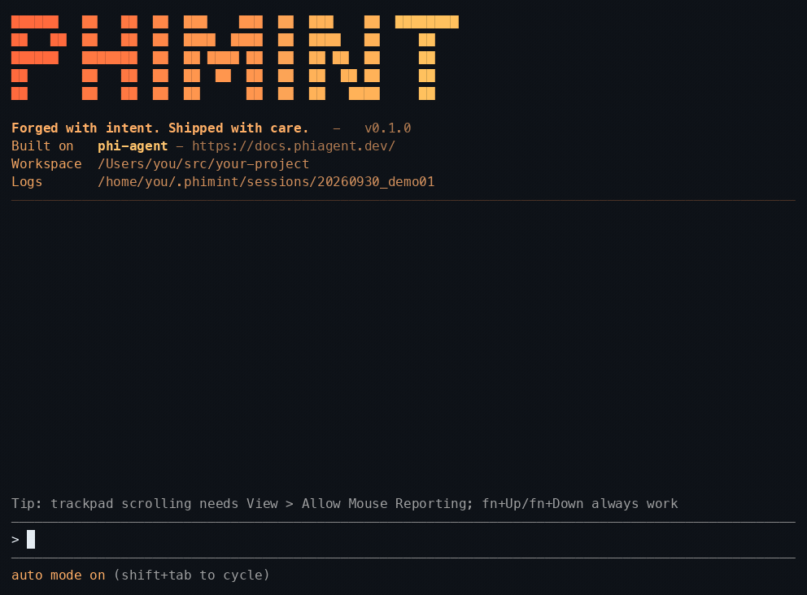

# phimint

**读作** `/ˈfaɪmɪnt/`（phi-mint，同英文 "fie-mint"），不是「皮敏特」。

**用 Rust 写的终端 AI 编程 agent——无需 Node.js/Python，单文件下载，1 核 1G 服务器丝滑跑完整个编码任务。**

基于 [phi-agent](https://docs.phiagent.dev/zh/) 构建——agent 运行时是独立发版的框架，phimint 只负责终端这一层。

[](LICENSE-MIT)
[](https://www.rust-lang.org)
[](README.md)



*phimint 只需在 `~/.phimint/config.json` 里配一个 API key——一分钟的事，见[快速开始](#快速开始)。*

产品页：[hibuka-labs.github.io/phimint/zh](https://hibuka-labs.github.io/phimint/zh/) — 中文 / [English](https://hibuka-labs.github.io/phimint/)。

**媒体报道** — [旋武社区「Rust 开源项目推荐」：phimint，Rust 写的轻量 AI 编码 Agent](https://xuanwu.openatom.org/articles/news/261124-project.html)（2026-11-24）；社区项目页：[xuanwu.openatom.org/project/phimint](https://xuanwu.openatom.org/project/phimint/)。

## 特性

- **天生就轻**——Rust 写的单个静态二进制，零运行时依赖：不装 Node.js、不配 Python 环境。SSH 到一台 1 核 1G 的裸服务器，curl 一行就是完整编码会话。
- **原生 LSP 快内环**——按语言懒启动（rust-analyzer / typescript-language-server / clangd），改完秒级拿到 `file:line:col` 诊断，不等重编译；tree-sitter 仓库地图 + ripgrep 按需取上下文，不整仓塞窗口。
- **CodeAct 跑机械活**——批量改名、数据整理这类活写进一段 Python 一次跑完，顶掉一长串单点工具调用。会话常驻：上次的变量、函数下次接着用，中间数据留在本地不进上下文——模型往返少了，token 就省在这里。没装 Python 不影响其余能力；引擎挂在编译期开关后面，`--no-default-features` 可整个摘除。
- **多 agent 并行**——几路调查一起跑：默认只读，写能力按次申请；报告在回合边界批量送到，不用轮询；任务面板逐个实时跟踪。
- **UI/产品设计支持**——布局、方案对比这类取舍，候选并排摆进浏览器画布，点一下就是真实用户回合——agent 不替你拍板；概念问题在终端选择器里问（`ask_user`，2–4 个候选）。
- **插件模式**——一切皆插件：MCP 服务、用户脚本、wasm 插件包走同一套契约（WIT + Component Model）接入，加能力不用动主程序；`/tools` 列出每个工具的来源、命名空间和权限档，一键关闭。
- **模型分档，钱花在刀刃上**——`main` 管对话，`lite` 跑子 agent 和摘要，`advanced` 啃硬活；便宜活不烧贵模型。
- **控制权在你**——审批三态 `auto` / `ask` / `deny`（子 agent 跟随）；secret 只以 `${ENV:VAR}` 引用落盘；桌面操作能看屏幕、挪指针，但凡改机器每次都问。

## 快速开始

三步跑起来：装上预编译二进制（**不需要 Rust**）、配上 API key、运行。

### 1. 安装

每个版本都提供预编译二进制（macOS / Linux / Windows，arm64 + x64）。
一键安装（国内用户直接用 Gitee 那行）：

```bash
curl -fsSL https://github.com/hibuka-labs/phimint/releases/latest/download/install.sh | bash   # GitHub
curl -fsSL https://gitee.com/chenkangzeng_admin/phimint/releases/download/latest/install.sh | PHIMINT_MIRROR=gitee bash  # Gitee 国内源
```

Windows（PowerShell）：

```powershell
irm https://github.com/hibuka-labs/phimint/releases/latest/download/install.ps1 | iex   # GitHub
$env:PHIMINT_MIRROR='gitee'; irm https://gitee.com/chenkangzeng_admin/phimint/releases/download/latest/install.ps1 | iex  # Gitee（国内）
```

安装脚本把整件事做完：二进制放进 `~/.local/bin`（PATH 自动处理好）、校验下载
的 sha256、写好 `~/.phimint/config.json`——留给你的只剩 `api_key` 那一行。
想自己管 PATH 就设 `PHIMINT_NO_PATH_EDIT=1`，指定安装目录用 `PHIMINT_INSTALL_DIR=<dir>`。

或使用包管理器：

```bash
brew install hibuka-labs/phimint/phimint   # macOS / Linux（Homebrew）
npm install -g phimint                   # 也支持 pnpm add -g / yarn global add
cargo install phimint                    # 从 crates.io
```

Windows 上还可以用 [Scoop](https://scoop.sh)：

```powershell
scoop bucket add hibuka-labs https://github.com/hibuka-labs/scoop-bucket
scoop install phimint                    # Scoop
```

升级：一键脚本安装的用 `phimint update`；其余按安装方式选
`brew upgrade phimint` / `npm install -g phimint@latest` / `cargo install phimint --force` /
`scoop update phimint`。
国内下载走 [Gitee Releases](https://gitee.com/chenkangzeng_admin/phimint/releases)，
更新检查器会自动兜底到 Gitee 镜像。

卸载：`phimint uninstall`——删掉二进制和 `~/.phimint/`（配置含 API key、会话、
历史），并摘掉安装脚本加进 PATH 的那条。`--keep-data` 保留数据，`--yes` 跳过确认。

### 支持平台

| 平台 | 下限 | 预编译产物 |
|---|---|---|
| Linux | glibc 2.28（Ubuntu 20.04、Debian 11、Rocky/Alma 8、Fedora 33+） | `x86_64`、`aarch64` |
| Windows | Windows 10 1809+（安装脚本需要 PowerShell 5.1+） | `x86_64` |
| macOS | 12+ | Apple Silicon、Intel |

Linux 二进制按 glibc 2.28 链接，老发行版也能起；CI 在 Linux / Windows / macOS
三平台构建测试。源码安装（`cargo install`）不受此限，跟本机工具链走。

### 2. 配置

一分钟的事：需要任一受支持的模型 provider 的 API key（OpenAI / Anthropic /
DeepSeek / Aliyun / Moonshot / Gemini / Ollama …）。

安装脚本已经写好了 `~/.phimint/config.json`——打开填上 `api_key` 那行就行。
换了别的安装方式就 `phimint init` 生成同一个文件，或用
`phimint config set api_key sk-xxx` 直接写。`phimint config show` 打印
phimint 实际读到的配置（key 打码）。

没有可用 key 时（文件里没有、`--api-key` 没给、`PHIMINT_API_KEY` 也没设），
phimint 在第一轮之前就停下，并点名要改哪个文件——它不会开一场付不起钱的
对话。endpoint 之后拒绝这个 key（401/403）时，转录里只留一条提示，点名那个
文件、打码的 key 和 endpoint：死掉的 key 改一行就好，不用去猜哪里错了。

文件是 JSON5，允许注释与尾逗号：

```json
{
  "base_url": "https://api.openai.com/v1",
  "api_key": "sk-xxx",
  "main": "gpt-5.4-mini",
  "lite": "gpt-4o-mini",
  "advanced": "o1-preview"
}
```

不同 provider 分层配置——每档可以是自带 `model` / `base_url` / `api_key` 的对象：

```json
{
  "main":     { "model": "gpt-5.4-mini", "base_url": "https://api.openai.com/v1", "api_key": "sk-openai" },
  "lite":     { "model": "deepseek-chat", "base_url": "https://api.deepseek.com/v1", "api_key": "sk-deepseek" },
  "advanced": { "model": "claude-opus-4", "base_url": "https://api.anthropic.com", "api_key": "sk-ant" }
}
```

三个档位，三种活：`main` 是你对话的主会话，`lite` 是便宜的那条道（子 agent
派发和回合末裁决器默认落在它上面），`advanced` 是留给重活的猛档。没配的档位
跟着 `main`，所以只有一个模型的配置也照样跑。`/lite <名字>` 和 `/advanced <名字>`
改档位，`/models` 列出当前配了哪些。

`/model` 切换只管本次会话：它写成顶层的 `model` 选择指针，覆盖 `main` 但不改写
档位定义。光打 `/model` 弹候选框（带一行「清除选择」），清除即回到配置的 `main`。

或使用 CLI 参数（完整字段见 `config.json.example`）：

```bash
phimint --model gpt-5.4-mini --base-url https://api.openai.com/v1 --api-key sk-xxx
```

`config.json` 还有可选段：`update`（自动更新检查的渠道与 manifest 端点）与
`ui.popup`（`@`/`/` 补全弹层的布局尺寸）。

### 3. 运行

```bash
cd your-project && phimint
```

在输入栏发一个任务——比如 `帮我在 lib 里加一个带缓存的 get_user 函数`——
它会读代码、改代码、编译、跑测试直到全绿。按键、审批模式与完整走读见[使用手册](docs/USAGE_CN.md)。

## 速查

| 按键 | 作用 |
|---|---|
| `Enter` | 发送 |
| `Ctrl+J` | 输入框换行 |
| `Shift+Tab` | 切换审批模式（`auto` ⇄ `ask`） |
| `Up` / `Down` | 翻历史输入 |
| `Ctrl+C` | 复制选中 → 中断运行 → 清空草稿 → 退出 |
| `Ctrl+V` | 粘贴截图 |
| `Esc` | 清除选中，否则清空输入 |

审批三档：`auto`（全自动）· `ask`（写操作逐次确认）· `deny`（只读）；
子 agent 跟随主 agent 的档位。

常用命令：`phimint update` · `phimint uninstall` · `phimint init` ·
`phimint config show` · `phimint --resume`。

完整键位表、全部参数、工具面、会话文件与内部结构：
**[docs/USAGE_CN.md](docs/USAGE_CN.md)** — [English](docs/USAGE.md)。

## 版本策略

phimint 目前是 **0.x**：每个发布的版本都能装、能跑、能自更新，但**公开 API 不承诺向后兼容**——
把它当库用时请锁精确版本（`phimint = "=0.13.0"`），1.0 之后会承诺 API 稳定。

细节见 [docs/versioning-policy.md](docs/versioning-policy.md)。

## 许可证

MIT OR Apache-2.0（见 [LICENSE-MIT](LICENSE-MIT) 与 [LICENSE-APACHE](LICENSE-APACHE)）。

## 联系

GitHub Issues — [hibuka-labs/phimint](https://github.com/hibuka-labs/phimint/issues)

如果 phimint 对你有用，点个 ⭐ 支持一下，让更多人发现它。

[English](README.md)
